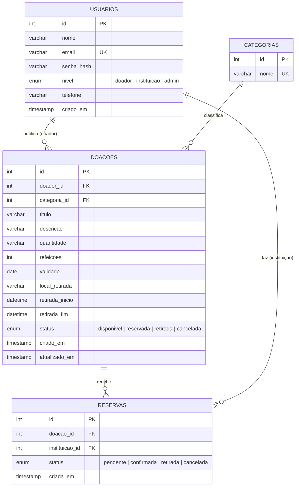

# Mesa Cheia — Entrega 2: Modelagem, banco de dados e primeira integração

Este documento atualiza a [proposta da Entrega 1](PROPOSTA.md) com requisitos, telas, modelagem do banco, rotas da API e permissões. A integração `React Native → fetch() → API Express → MySQL` já está funcionando para a entidade principal (**doações**).

## 1. Requisitos funcionais atualizados

| Código | Requisito | Quem | Situação |
|---|---|---|---|
| RF01 | Listar doações disponíveis e dentro da validade | Instituição, Admin | ✅ Entrega 2 (API + app) |
| RF02 | Filtrar doações por categoria | Instituição, Admin | ✅ Entrega 2 (filtro no app) |
| RF03 | Ver detalhes de uma doação | Instituição, Admin | ✅ Entrega 2 |
| RF04 | Publicar uma doação | Doador | ✅ Entrega 2 (sem login ainda) |
| RF05 | Editar e cancelar a própria doação | Doador | ⏳ Entrega 3 (CRUD completo) |
| RF06 | Cadastrar-se e entrar com e-mail e senha | Todos | ⏳ Entrega 3 |
| RF07 | Reservar uma doação | Instituição | ⏳ Entrega 3 |
| RF08 | Confirmar a retirada | Doador | ⏳ Entrega 3 |
| RF09 | Ver histórico das próprias doações/reservas | Doador, Instituição | ⏳ Entrega 3/4 |
| RF10 | Gerenciar usuários e níveis | Admin | ⏳ Entrega 3 |
| RF11 | Moderar ou remover doações | Admin | ⏳ Entrega 3 |

### Requisitos não funcionais

| Código | Requisito |
|---|---|
| RNF01 | Senhas armazenadas somente com hash (bcrypt), nunca em texto — Entrega 3 |
| RNF02 | Toda entrada é validada no servidor; consultas SQL usam parâmetros `?` (sem concatenar dados) |
| RNF03 | Erros da API não expõem SQL, credenciais ou stack trace |
| RNF04 | Segredos e senhas ficam em `.env`, fora do repositório |
| RNF05 | O app mostra estados de carregamento e de erro quando a API não responde |

## 2. Telas e fluxos atualizados

| Tela | Para quem | O que mudou na Entrega 2 |
|---|---|---|
| Boas-vindas | Todos | — |
| Entrar | Todos | Continua só visual (login real na Entrega 3) |
| Início | Logados | Contadores agora vêm da API |
| Doações disponíveis | Instituição, Admin | Lista da API, filtro por categoria, puxar para atualizar, botão **Publicar doação** |
| Detalhes da doação | Instituição, Admin | Busca `GET /doacoes/:id` |
| **Publicar doação** (nova) | Doador | Formulário que envia `POST /doacoes` |
| Como funciona | Todos | — |
| Criar conta, Minhas ofertas, Minhas reservas, Gerenciar usuários | — | ⏳ Entrega 3 |

```
Boas-vindas ──► Entrar ──► Início ──┬──► Doações ──► Detalhes da doação
      │                              │       │
      └──► Como funciona ◄───────────┤       └──► Publicar doação ──(salva)──► volta e a lista recarrega
                                     └──► Publicar doação
```

## 3. Estrutura do banco de dados (MySQL)

Script completo: [`database/mesa_cheia.sql`](../database/mesa_cheia.sql).

### Diagrama de entidades e relacionamentos



### Dicionário de dados

**usuarios** — quem usa o app

| Campo | Tipo | Regras |
|---|---|---|
| id | INT UNSIGNED | PK, auto incremento |
| nome | VARCHAR(120) | obrigatório |
| email | VARCHAR(150) | obrigatório, **único** |
| senha_hash | VARCHAR(255) | obrigatório; guardará o hash do bcrypt (Entrega 3) |
| nivel | ENUM | `doador` (padrão), `instituicao`, `admin` |
| telefone | VARCHAR(20) | opcional |
| criado_em | TIMESTAMP | padrão: agora |

**categorias** — tipo de alimento (Refeições, Padaria, Hortifruti, Mercearia)

| Campo | Tipo | Regras |
|---|---|---|
| id | INT UNSIGNED | PK |
| nome | VARCHAR(60) | obrigatório, **único** |

**doacoes** — entidade principal

| Campo | Tipo | Regras |
|---|---|---|
| id | INT UNSIGNED | PK |
| doador_id | INT UNSIGNED | FK → `usuarios.id` |
| categoria_id | INT UNSIGNED | FK → `categorias.id` |
| titulo | VARCHAR(120) | obrigatório |
| descricao | VARCHAR(500) | opcional (padrão vazio) |
| quantidade | VARCHAR(60) | obrigatório (ex.: "20 marmitas") |
| refeicoes | INT UNSIGNED | estimativa de refeições (para o contador de impacto) |
| validade | DATE | obrigatório; não pode ser no passado (validado na API) |
| local_retirada | VARCHAR(120) | obrigatório |
| retirada_inicio / retirada_fim | DATETIME | obrigatórios; `CHECK` garante fim > início |
| status | ENUM | `disponivel` (padrão), `reservada`, `retirada`, `cancelada` |
| criado_em / atualizado_em | TIMESTAMP | automáticos |

**reservas** — instituição reserva uma doação (rotas na Entrega 3)

| Campo | Tipo | Regras |
|---|---|---|
| id | INT UNSIGNED | PK |
| doacao_id | INT UNSIGNED | FK → `doacoes.id` |
| instituicao_id | INT UNSIGNED | FK → `usuarios.id` (usuário de nível `instituicao`) |
| status | ENUM | `pendente` (padrão), `confirmada`, `retirada`, `cancelada` |
| criada_em | TIMESTAMP | padrão: agora |

### Decisões de modelagem

- **Categorias em tabela própria**: evita textos repetidos e erros de digitação, e permite filtrar por `categoria_id`.
- **Um único campo `nivel` em `usuarios`**: com três níveis fixos, `ENUM` é mais simples do que uma tabela de papéis.
- **`reservas` separada de `doacoes`**: mantém o histórico (uma reserva pode ser cancelada e a doação voltar a ficar disponível).
- **Chaves estrangeiras sem exclusão em cascata**: apagar um usuário não apaga doações em silêncio.
- **Regra "uma única reserva ativa por doação"**: será garantida no código da Entrega 3 (o MySQL não tem índice único parcial).

## 4. Rotas da API

Base: `http://localhost:3000`. Formato: JSON.

| Método | Rota | Função | Quem poderá usar | Situação |
|---|---|---|---|---|
| GET | `/` | Informações da API | Público | ✅ |
| GET | `/categorias` | Lista categorias | Logados | ✅ (aberta na Entrega 2) |
| GET | `/doacoes` | Lista doações disponíveis (`?categoria_id=`) | Logados | ✅ (aberta na Entrega 2) |
| GET | `/doacoes/:id` | Detalhe de uma doação | Logados | ✅ (aberta na Entrega 2) |
| POST | `/doacoes` | Cadastra doação | Doador, Admin | ✅ (aberta na Entrega 2) |
| PUT | `/doacoes/:id` | Edita doação | Doador (dono), Admin | ⏳ Entrega 3 |
| DELETE | `/doacoes/:id` | Cancela/remove doação | Doador (dono), Admin | ⏳ Entrega 3 |
| POST | `/auth/cadastro` | Cria conta (senha com hash) | Público | ⏳ Entrega 3 |
| POST | `/auth/login` | Valida credenciais e devolve o JWT | Público | ⏳ Entrega 3 |
| POST | `/doacoes/:id/reservas` | Reserva uma doação | Instituição | ⏳ Entrega 3 |
| GET | `/usuarios` / PUT `/usuarios/:id/nivel` | Gerencia usuários e níveis | Admin | ⏳ Entrega 3 |

### Exemplos

**`GET /doacoes`** → `200`

```json
[
  {
    "id": 1,
    "titulo": "Marmitas do almoço",
    "descricao": "Arroz, feijão, frango assado e salada.",
    "quantidade": "25 marmitas",
    "refeicoes": 25,
    "validade": "2026-11-06",
    "local_retirada": "Centro",
    "retirada_inicio": "2026-11-06 15:00:00",
    "retirada_fim": "2026-11-06 16:00:00",
    "status": "disponivel",
    "categoria_id": 1,
    "categoria": "Refeições",
    "doador_id": 1,
    "doador": "Restaurante Sabor da Vila"
  }
]
```

**`POST /doacoes`**

```json
{
  "titulo": "Pães do dia",
  "quantidade": "2 caixas",
  "refeicoes": 20,
  "validade": "2026-11-08",
  "local_retirada": "Bairro Jardim",
  "retirada_inicio": "2026-11-06 19:00",
  "retirada_fim": "2026-11-06 20:00",
  "categoria_id": 2
}
```

→ `201` `{ "mensagem": "Doação cadastrada com sucesso.", "doacao": { "id": 6, ... } }`

| Situação | Resposta |
|---|---|
| Dado inválido (título vazio, data inexistente, fim antes do início…) | `400` com `mensagem` explicando |
| `categoria_id` ou `doador_id` que não existe | `400` "Categoria ou doador não encontrado." |
| `GET /doacoes/999` | `404` "Doação não encontrada." |
| ID não numérico (`/doacoes/abc`) | `400` "ID da doação inválido." |
| JSON malformado | `400` "JSON inválido no corpo da requisição." |
| Falha no banco | `500` com mensagem genérica |

> **Atenção (temporário):** como ainda não há login, o `POST /doacoes` aceita `doador_id` opcional (padrão: 1). Na Entrega 3 o doador passará a vir do **JWT** e esse campo do corpo será ignorado.

## 5. Níveis de usuário e permissões previstas

| Ação | Doador | Instituição | Admin |
|---|:---:|:---:|:---:|
| Ver doações disponíveis | ✅ | ✅ | ✅ |
| Publicar doação | ✅ | ❌ | ✅ |
| Editar/cancelar doação | só as **suas** | ❌ | ✅ qualquer |
| Reservar doação | ❌ | ✅ | ❌ |
| Ver as próprias reservas | ❌ | ✅ | ✅ todas |
| Gerenciar usuários e níveis | ❌ | ❌ | ✅ |

As permissões serão aplicadas **no back-end** (middleware que valida o JWT e confere o `nivel`, e checagem de dono nas rotas de edição). O app apenas esconde botões; quem protege os dados é a API.

## 6. Como testar a integração

1. Criar o banco: `mysql -u root -p < database/mesa_cheia.sql`
2. Copiar `backend/.env.example` para `backend/.env` e preencher `DB_PASSWORD`.
3. `npm install` e `npm run api` — deve imprimir "Conectado ao MySQL".
4. Abrir `http://localhost:3000/doacoes` no navegador: deve listar as doações de exemplo.
5. `npx expo start` e abrir o app: a lista e o contador do Início vêm da API; **Publicar doação** grava no MySQL.
6. No celular com Expo Go, definir `EXPO_PUBLIC_API_URL` com o IP do computador (ver `.env.example`).

Testes automatizados (sem precisar de banco): `npm test` — valida as regras de entrada da API e os formatadores do app.
